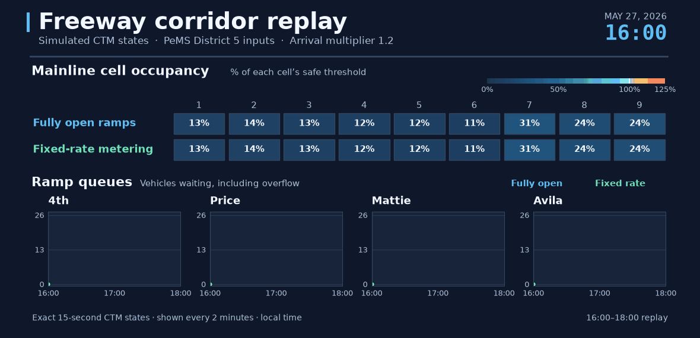
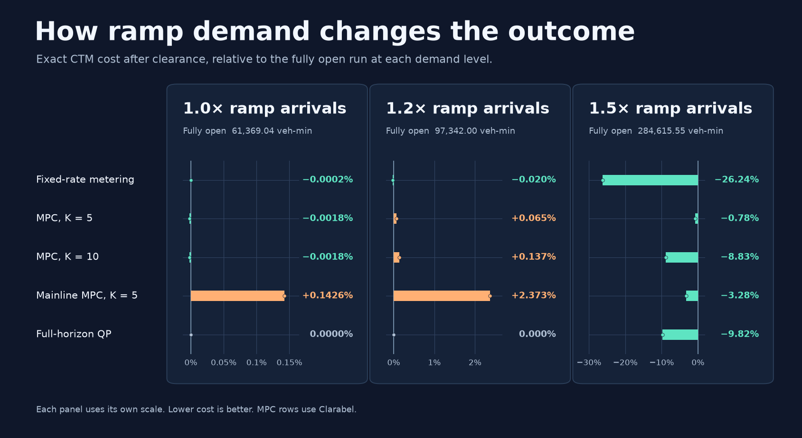

# ADMM-MPC Ramp Metering

**Pismo freeway corridor** · 9 mainline cells · 4 controlled ramps · 15-second CTM

[Results](#results) · [Ramp demand sensitivity](#ramp-demand-sensitivity) · [How to run](#how-to-run) · [Project files](#project-files)

How much can ramp metering improve a freeway corridor when the score includes the time vehicles spend waiting on ramps? This project compares fully open ramps, fixed-rate metering, a full-horizon convex QP, and receding-horizon MPC using a 9-cell Cell Transmission Model (CTM) driven by observed Caltrans PeMS District 5 detector data.



*Simulated traffic from 16:00 to 18:00 on May 27, 2026, at the default ramp arrival multiplier of 1.2. The animation advances two minutes per frame. The queue plots use the underlying 15-second simulation states.*

## Results

**The best fixed-rate policy scored 97,322.95 at 1.2**, about 19 vehicle-minutes below fully open ramps. The table shows exact CTM costs in vehicle-minutes, including the clearance period. Lower is better.

| Policy | Cost after clearance | Change vs. fully open |
| --- | ---: | ---: |
| Fully open benchmark | 97,342.00 | 0.000% |
| Best fixed rate found | **97,322.95** | **−0.020%** |
| Full-horizon convex QP replay | 97,342.00 | 0.000% |
| Standard MPC, K = 5 | 97,404.90–97,404.95 | +0.065% |
| Standard MPC, K = 10 | 97,475.27–97,475.37 | +0.137% |
| Mainline-focused MPC, K = 5, AW = 2.3 | 99,652.31–99,652.95 | +2.373% to +2.374% |

The K = 10 Clarabel run cut freeway time by **3,078 vehicle-minutes** and added **2,829 vehicle-minutes** of ramp waiting. Its higher fairness cost also contributed to a **133.37 vehicle-minute** increase in total cost. The mainline-focused run uses a higher planning weight and caps ramp commands at observed ramp flow times the arrival multiplier. Scoring uses the same benchmark weights for every policy.

<details>
<summary>Scoring, solver settings, and the PDF comparison</summary>

The benchmark notebook scores the 480-step window at **88,338.75**. The standalone Python script adds **9,003.25** in clearance cost over 151 extra steps. During clearance, new demand stops and ramps open fully. Ramp service and backlog are measured at the end of the original two hours.

The objective combines mainline time spent, waiting in ramp and entry queues, fairness, weighted safety-threshold exposure, and weighted spillback exposure. Fairness uses the step-average physical and overflow queues divided by ramp storage. The normalized stress stays sensitive to spillback above storage capacity.

Standard MPC uses `AW = 1` and a 30-minute terminal queue weight in the planning QP. It applies the first command, advances the exact CTM, and replans every 15 seconds. The ranges in the table cover Clarabel and OSQP-first runs. The mainline-focused OSQP-first run used Clarabel for 17 windows.

The full-horizon sequential QP accepted no improving step at 1.2, so it retained the fully open policy. The fixed-policy search chooses one constant cap per ramp using the two-hour objective. Its selected caps at 1.2 were 11.253104, 14.769074, 3.060000, and 2.219721 vehicles per 15 seconds at 4th, Price, Mattie, and Avila, respectively.

The fully open and fixed-rate totals match the July 12 report at its displayed precision. The standard K = 5 total rounds to the report’s 97,405, with different component costs and ramp backlog. The reconstructed K = 10 run is about 154 vehicle-minutes below the report’s 97,629.

[Project setup and validation details](./%23%20Project%20Setup%20Report.md)

</details>

## Ramp demand sensitivity



Estimated ramp demand is observed ramp discharge multiplied by the arrival multiplier. Fixed rates were searched separately at each multiplier using the two-hour objective. The chart shows each policy’s clearance-adjusted change relative to fully open ramps at the same demand level.

At **1.0**, K = 10 MPC saved about **1.13 vehicle-minutes** versus fully open ramps. At **1.5**, the best fixed-rate policy scored **209,929.11**, down **26.24%** from the fully open score of **284,615.55**.

## How to run

Keep the notebooks, script, and both PeMS files in the repository root. Select your Python environment in Jupyter or VS Code and install the dependencies.

```powershell
python -m pip install numpy pandas matplotlib seaborn scipy cvxpy clarabel osqp ipykernel nbformat
```

Run the benchmark check outside Jupyter from the repository folder.

```powershell
python .\Benchmark_calculation.py
```

For the full comparison, run the notebooks in the order listed below. Select **Run All** in each notebook.

## Project files

| File | Purpose |
| --- | --- |
| [Benchmark_calculation.ipynb](Benchmark_calculation.ipynb) | Build the 9-cell benchmark, run and validate the fully open policy, and export shared inputs. |
| [fixed_policy.ipynb](fixed_policy.ipynb) | Search for one constant release cap per ramp. |
| [Benchmark_convex_QP.ipynb](Benchmark_convex_QP.ipynb) | Test full-horizon sequential QP candidates through the exact CTM. |
| [ADMM_MPC.ipynb](ADMM_MPC.ipynb) | Run K = 5 and K = 10 receding-horizon controllers with Clarabel and OSQP. |
| [ADMM_MPC_mainlinedelay_focus.ipynb](ADMM_MPC_mainlinedelay_focus.ipynb) | Run the separate mainline-weighted controller experiment. |
| [Benchmark_calculation.py](Benchmark_calculation.py) | Report two-hour and clearance-adjusted benchmark scores using the notebook and raw data in memory. |

<details>
<summary>PeMS inputs and corridor layout</summary>

The benchmark uses [PeMS station metadata](d05_text_meta_2026_04_28.txt) and [five-minute detector observations](d05_text_station_5min_2026_05_27.txt) to build the 15-second CTM inputs. The benchmark notebook generates `shared_benchmark_inputs.pkl`. The current notebooks and standalone script use the benchmark notebook and raw input files to construct their model inputs.

| Controlled ramp | Mainline cell |
| --- | ---: |
| 4th | 2 |
| Price | 2 |
| Mattie | 6 |
| Avila | 9 |

Cell 9 has a flow capacity of 2,400 vehicles per hour. Avila’s merge priority is `0.3`.

</details>
